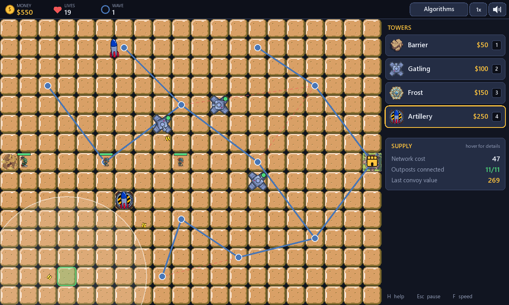
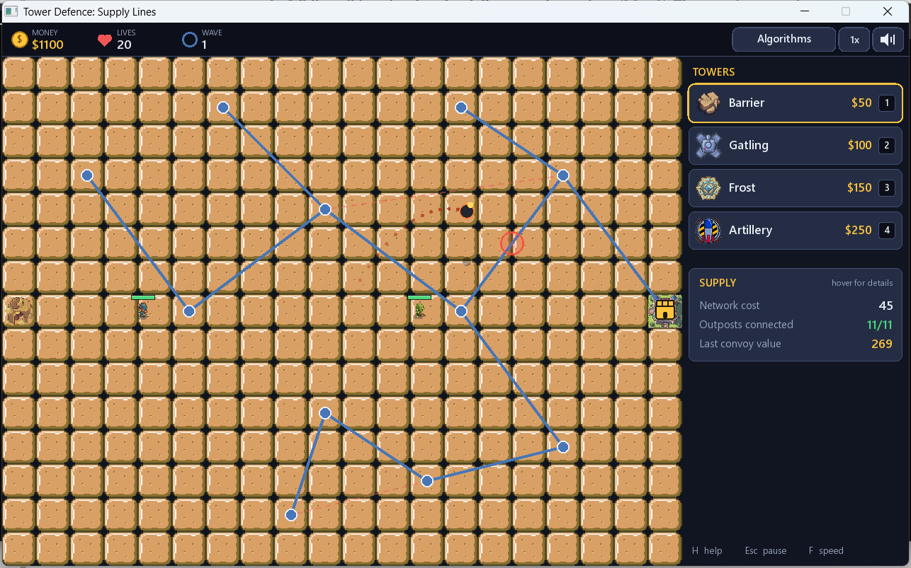
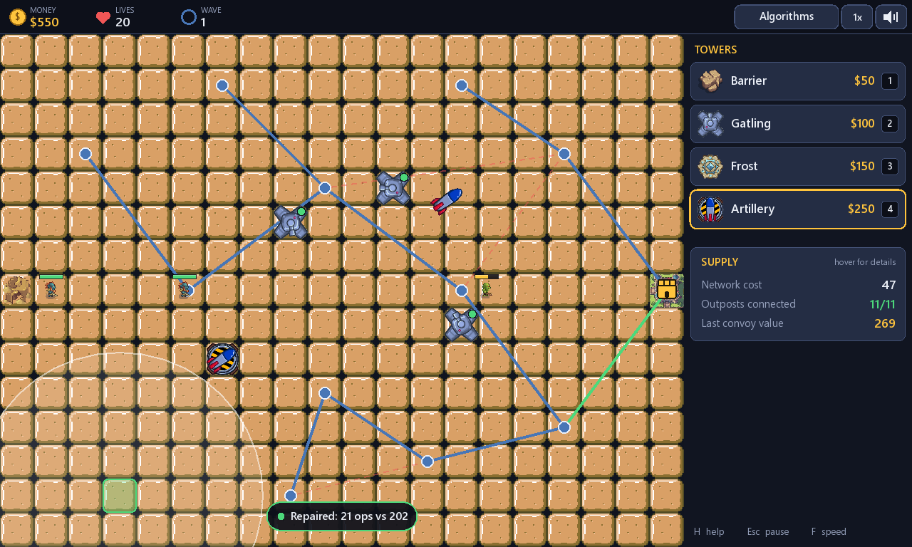
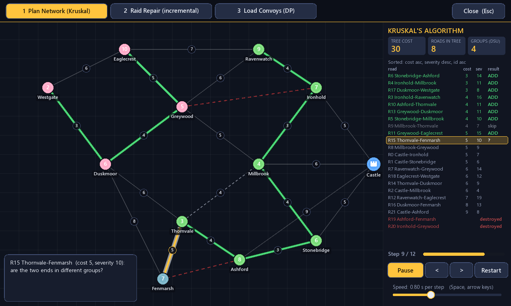
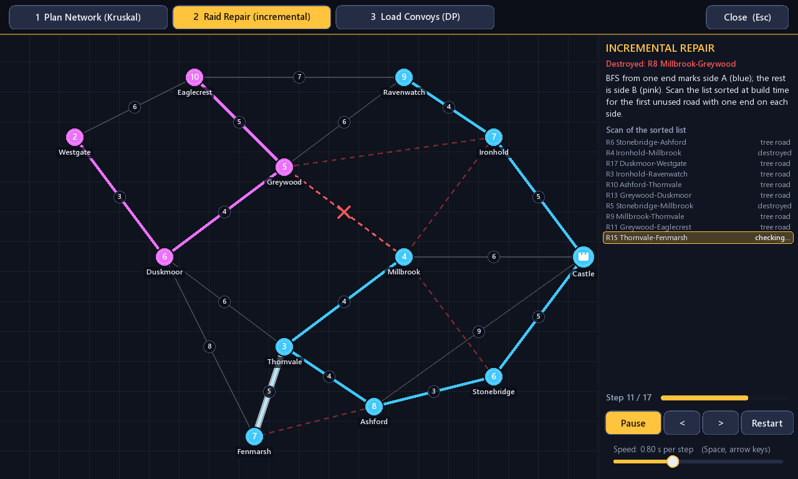
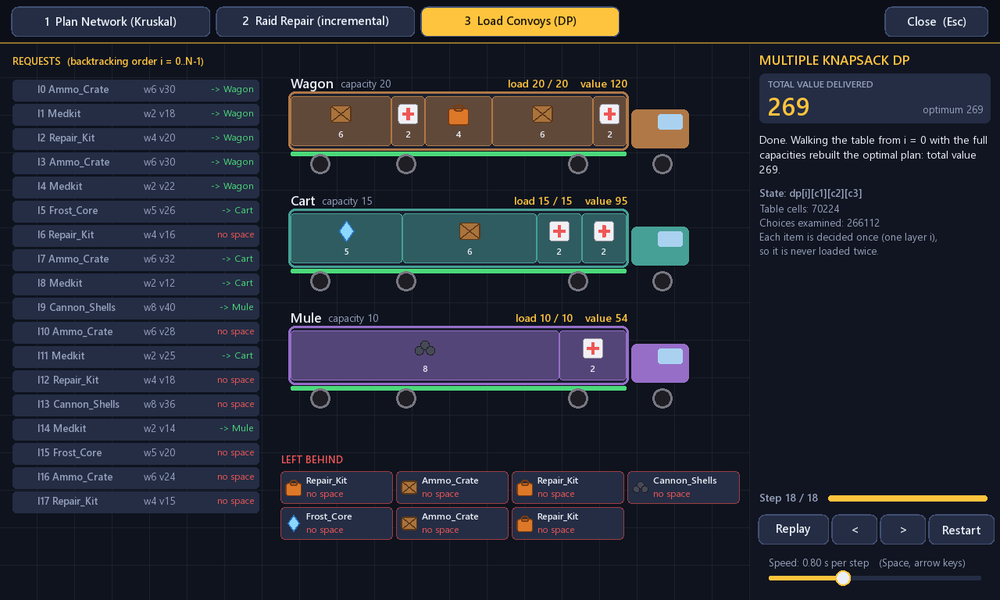

# Tower Defence: Supply Lines

A C++ / SFML 3 tower defence game built around two classic algorithms.
Made for the **CT-363 Design and Analysis of Algorithms** Complex Engineering Problem.

* **Part A – Greedy: Kruskal's minimum spanning tree.** The Castle is linked to 11 outposts by supply roads. Kruskal (with a disjoint set) picks the cheapest set of roads that connects everyone. When enemies destroy a road during a wave, the tree is **repaired incrementally**: the cheapest road that crosses the split replaces it.
* **Part B – Dynamic programming: multiple 0/1 knapsack.** Between waves, three convoys (Wagon 20, Cart 15, Mule 10) are packed with the requested items for the **highest total value**. Outposts that are cut off from the Castle get nothing.
* Enemies find their way with **A\*** (with a binary min-heap).



| An enemy bombs a road (1 s before the raid) | Raid repaired (incremental update) |
|---|---|
|  |  |
| **Plan Network view (Kruskal step by step)** | **Raid Repair view (cut property)** |
|  |  |
| **Load Convoys view (DP result)** | |
|  | |

## Features

* 4 towers (Barrier, Gatling, Frost, Artillery) and 4 enemy types (Soldier, Runner, Tank, Shielded); each wave features one type, and every 5th wave is mixed.
* A* pathfinding. A tower that would block the only path is refused, and frost makes tiles slower, so enemies may walk around them.
* **Supply map**: blue roads = the minimum spanning tree; small dots = outposts (grey = cut off); gold keep = the Castle.
* **Raids**: 3 roads destroyed per wave. One second before each raid, the enemy closest to the road throws a bomb at it; when it lands, the road flashes red, the replacement shows green, and a toast shows the work done, e.g. "Repaired: 21 ops vs 202" (incremental vs full rebuild).
* **Supply phase** after every wave: the DP packs the convoys. Towers near a supplied outpost fire 25 % faster (green dot); near a cut-off outpost, 25 % slower (red dot).
* **Three algorithm views** (step by step, with play/pause/step/speed): Plan Network (Kruskal), Raid Repair (incremental update), Load Convoys (DP backtracking).
* Hover tooltips for every road, outpost, tower and enemy; a Supply box with the key numbers.
* Console test runner: **15 test groups, 69 checks** (tie-break, disconnected graph, over-demand, items too heavy, DP vs brute force, incremental vs rebuild, raid rule, …).
* No image or sound files are needed for the UI: the menu picture and the sounds are generated in code.

Project layout: `core/` = the algorithms (standard C++ only, no SFML), `App/` = the game (SFML), `tests/` = test programs, `data/` = datasets, `Assets/` = pictures and a font.
Every file and every algorithm line is explained in **[CODE_EXPLANATION.md](CODE_EXPLANATION.md)**.

---

## 1. Install (Windows 10/11)

The compiler and SFML **must match exactly**: GCC 14.2.0 MinGW (UCRT, 64-bit) with the SFML 3.0.2 package built for that compiler.

| Tool | Download | Notes |
|---|---|---|
| **Git** | `winget install --id Git.Git -e` or https://git-scm.com/download/win | To clone the repository. |
| **CMake 3.21+** | `winget install --id Kitware.CMake -e` or https://cmake.org/download/ | Tick "Add CMake to the PATH" if you use the installer. |
| **MinGW-w64 GCC 14.2.0** (64-bit, POSIX threads, UCRT) | https://winlibs.com/ (GCC 14.2.0 + MinGW-w64 UCRT, Win64 zip), or the compiler link on the SFML download page | Unzip so that `C:\mingw64\bin\g++.exe` exists, and add `C:\mingw64\bin` to the PATH. Don't use winget for this one: it installs the newest GCC, which doesn't match SFML 3.0.2. |
| **SFML 3.0.2** – "GCC 14.2.0 MinGW (SEH) 64-bit" | https://www.sfml-dev.org/download/sfml/3.0.2/ | Unzip to `C:\SFML-3.0.2\` so that `C:\SFML-3.0.2\SFML-3.0.2\lib\cmake\SFML\SFMLConfig.cmake` exists. |

Check in a new PowerShell window:

```powershell
git --version
cmake --version          # 3.21 or newer
g++ --version            # must say 14.2.0
```

If SFML is in another folder, add `-DSFML_DIR="<your folder>\lib\cmake\SFML"` to the first `cmake` command below.

## 2. Build

```powershell
git clone https://github.com/OwaisKamran/Tower-Defence-Supply-Lines.git
cd Tower-Defence-Supply-Lines
cmake -S . -B build -G "MinGW Makefiles"
cmake --build build
```

This creates `build\tower_defense.exe` (the game) and `build\test_runner.exe` (the tests). The four SFML DLLs are copied next to the game automatically.

## 3. Run the game

The game loads `..\Assets\` and `..\data\`, so start it **inside** `build\`:

```powershell
cd build
.\tower_defense.exe
```

(Double-clicking `build\tower_defense.exe` also works.)

## 4. Run the tests

From the repository folder:

```powershell
.\build\test_runner.exe data                   # last line: 69 checks passed, 0 failed
cmake --build build --target test_output       # optional: saves the output to docs\test_output.txt
```

Optional A* vs Dijkstra check (uses the game's grid, so it needs SFML):

```powershell
cmake -S . -B build -DBUILD_ASTAR_CHECK=ON
cmake --build build --target astar_check
cd build; .\astar_check.exe
```

## 5. Controls

| Key / mouse | Action |
|---|---|
| `1` `2` `3` `4` or click a card | Select Barrier / Gatling / Frost / Artillery |
| Left click on the battlefield | Place the selected tower |
| `Space` | Start the next wave now |
| `P` | **Plan Network** view – Kruskal step by step |
| `V` | **Raid Repair** view – the last incremental update step by step |
| `L` | **Load Convoys** view – the DP packing |
| **Algorithms** button | Small menu with the same three views |
| `D` | An enemy bombs the next road now (demo); inside a view it raids at once |
| `M` | Show / hide the supply map |
| `F` or `1x` button | Game speed 1× / 2× |
| `N` or speaker button | Mute / unmute |
| `H` | Help panel (keys and map legend) |
| `Esc` | Pause menu, or close a view / the Algorithms menu |
| `R` | Restart on the game-over screen |
| Hover | Tooltip for any road, outpost, tower, enemy, tower card or the Supply box |

Inside a view: `Space` play/pause, `←` `→` step back/forward, `1`–`3` switch views, slider = speed, `Esc` close.

## 6. Run without a compiler (ready-made build)

`build\` is not stored in the repository. To run the game on a PC with no compiler, first build it on a PC that has one, then add the three MinGW runtime DLLs next to the game:

```powershell
Copy-Item C:\mingw64\bin\libstdc++-6.dll, C:\mingw64\bin\libgcc_s_seh-1.dll, C:\mingw64\bin\libwinpthread-1.dll build\
```

Copy these to the other PC (for example on a USB stick), keeping the same folder layout:

```
Tower-Defence-Supply-Lines\
  Assets\                    pictures and font
  data\                      datasets
  build\tower_defense.exe    the game
  build\test_runner.exe      the tests
  build\*.dll                7 DLLs: sfml-graphics-3, sfml-window-3, sfml-system-3, sfml-audio-3,
                             libstdc++-6, libgcc_s_seh-1, libwinpthread-1
```

On that PC, run `build\tower_defense.exe`; for the tests, run `.\build\test_runner.exe data` from the main folder. Windows 10 and 11 already include the UCRT runtime the programs need.

## 7. Troubleshooting

| Problem | Fix |
|---|---|
| "`libstdc++-6.dll` / `libgcc_s_seh-1.dll` / `libwinpthread-1.dll` was not found" | Add `C:\mingw64\bin` to the PATH, or copy the three DLLs next to the exe (section 6). |
| "`sfml-graphics-3.dll` was not found" | Run `cmake --build build` again (it copies the SFML DLLs), or copy them from `C:\SFML-3.0.2\SFML-3.0.2\bin\`. |
| CMake: "Could not find a package configuration file provided by SFML" | Pass `-DSFML_DIR="<SFML folder>\lib\cmake\SFML"`. |
| Link errors like `undefined reference to sf::...` | Compiler and SFML don't match. Use GCC **14.2.0 UCRT 64-bit** with the **GCC 14.2.0** SFML package. |
| `g++` or `mingw32-make` not recognised | `C:\mingw64\bin` is not on the PATH. Add it, then open a new terminal. |
| The window opens with missing pictures / "Failed to load" in the console | The game was started from the wrong folder: `cd build` first. |
| No supply roads on the map ("Supply map not loaded") | The `data\` folder is missing next to `build\`. |
| Text looks pixelated | Segoe UI wasn't found, so the bundled pixel font is used; everything still works. |
| CMake complains about a different generator | Delete the `build\` folder and run the two `cmake` commands again. |
| `test_runner` prints "Cannot load ..." | Run it from the main folder with the argument `data`. |
